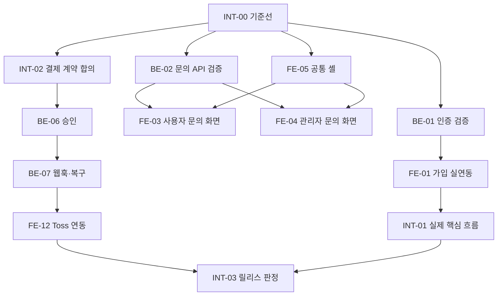

# TASKS — 방식 A: FE·BE·Integration 통합 보드

> **작업본 안내:** 원본 자료집의 FE 기준은 `f9427a9`입니다. 현재 작업본의 코드 차이·경로·누락 자료는 [프론트엔드 작업 시작 안내](FRONTEND_WORKSPACE.md)를 먼저 확인하세요. 원본의 과거 진단과 미실행 상태를 현재 사실로 단정하지 않습니다.

> **이 파일은 통합 방식입니다.** 아래 표는 FE/BE/Integration 작업을 **담당 영역 별도로 표기하되** 한곳에서 의존관계를 보고 조율하는 용도입니다. 개인 개발 AI에 작업을 넘길 때는 `tasks_split/FRONTEND_TASKS.md` 또는 `tasks_split/BACKEND_TASKS.md`를 사용합니다.
>
> 모든 상태의 기준은 아래 **진행 현황 체크리스트**이며, 완료는 수용 기준의 실제 증거가 있을 때만 표시합니다. 문서 버전 v0.7.6 (2026-11-07 FE-19 상태 추가). G0~G5 및 API v1.0.1 준수.

## 진행 현황 체크리스트

> `[x]` = 완료(증거 있음), `[ ]` = 미완료. 상세 증거는 [FE 티켓](tasks_split/FRONTEND_TASKS.md)의 같은 ID를 봅니다.
> 체크박스는 **수용 기준 충족** 기준이라, 코드가 일부 있어도 증거가 없으면 `[ ]`입니다.

**완료**
- [x] **FE-00** 실제 배포 FE 기준선·UI 경로 확인 — `majayong.vercel.app`, `e89e743` 배포 대조, 프록시 401 확인
- [x] **FE-01** 이메일 회원가입 3단계 — 프로덕션 `POST /api/v1/auth/register` 201, 동의 3개 초기 미체크·NDA-only `PATCH /api/v1/me/supplier-profile` 200·`ndaAgreedAt`·`/s` 확인
- [x] **FE-03** 고객센터 FAQ·1:1 문의 — FAQ 14개·빠른 검색·비로그인 안내·내 문의/상세·첨부 3개 업로드/다운로드, 485/485
- [x] **FE-05** 푸터·메뉴·약관 셸 — navy-900 푸터, Terms 역할 셸, 랜딩 앵커, 1440/390 overflow 0
- [x] **FE-06** 랜딩 2종 — 가치 카드 3장, 예치 과장 문구 제거, 1440/390 overflow 0
- [x] **FE-08** 계정 증빙·정산 정보 — 로컬 세금·계좌 PATCH 200, 마스킹 표시, 1원 인증 미지원 안내
- [x] **FE-10** 검수·납품 — D-26 `items[].id`로 납품·승인·보완 실연결
- [x] **FE-11** 계약·정산 실데이터 — 계약 픽스처로 목록 금액·정산 고지 실확인
- [x] **FE-16** 변경 영역 QA — 보드 57/57 대응, 1440/390 overflow 0, 변경 14화면 대조·468/468
- [x] **FE-17** 리뷰 작성·받은 리뷰 실제 API — `3b6919f`, staging 리뷰 201·받은 리뷰 1건, production `fgtpf2s80`
- [x] **FE-18** 계약 완료 배너·정산 라벨 — `c435a4b`/`f2ad121`, 완료 문구·세후 라벨, production `lh28yr0l2`
- [x] **FE-14** ChatIndex 고정 데모 링크 제거 — `GET /me/chats` 기반, 프로덕션 번들에 빈 상태·API 반영 확인

**진행 중**
- [x] **FE-02** 비밀번호 재설정 — 샌드박스 request 200·성공 화면 확인; 실제 메일은 no-op(발송 안 함)
- [x] **FE-04** 운영자 1:1 문의 — staging ADMIN 부트스트랩·목록·UI 답변·배지 1→0 PASS
- [x] **FE-07** 문의 답변 알림 링크 — 실제 답변 알림·상세 이동 PASS; `tab=my` 처리 수정 `70cbcbc`
- [x] **FE-09** 운영자 후처리 상태 — 세 관리자 화면 실제 API 저장 연결(staging reports/blocks 확인, disputes 빈 목록)
- [x] **FE-13** NDA·지원·채팅·합의·서명 회귀 — staging 1~7 PASS, 보호 코드 무변경
- [x] **FE-19** 명세 확정 선행조건 차단·오류 안내 — staging 상호 미등록 게시 201·대기 기능 409·상세 필드 은닉 확인

**현재 FE 실행 가능 상태 (2026-11-06)**
- FE-17·FE-18·FE-12·FE-04/07/13·INT-02·FE-09·FE-15는 완료됐습니다. INT-03은 staging GO·production demo-complete로 판정했습니다. Toss·메일·계좌 인증은 샌드박스 성공으로 닫았고, 남은 것은 production 프로젝트/DB 분리·법률 문안·공식 ADMIN 절차입니다.
- FE-12는 샌드박스 승인 E2E·실제 웹훅 200·자동 Cron 복구까지 확인했고, 테스트 키와 `VITE_ENABLE_DEPOSIT=true`로 배포했습니다. live 결제는 범위에서 제외합니다.
- FE-02의 실제 메일은 샌드박스 no-op로 처리했고, FE-15 검색·취소 철회 확장은 staging에서 닫았습니다.

**대기 (Next/Later)**
- [x] **FE-15** 검색·취소 철회 확장 — staging search 200·cancel 201·withdraw 200·ACTIVE 복귀 확인

**차단 (외부 계약·증거 필요)**
- [x] **FE-12** Toss 예치 SDK 연결 — 샌드박스 승인 E2E PASS(가상계좌), 테스트 client key·`VITE_ENABLE_DEPOSIT=true` 배포

**BE · Integration (이 저장소 밖)**
- [x] **BE-00** API 기준선·staging 검증
- [x] **BE-01** auth/register/reset/Google/role 검증 — mail provider는 범위 밖; 발송 안전 게이트·staging 메일 검증은 BE-12
- [x] **BE-02** 고객센터 문의 5개 API — 로컬 GET/POST/상세 200, 비관리자 403 확인
- [x] **BE-03** 문의 답변 알림 targetUrl
- [x] **BE-04** NDA/specItemId/지원·채팅·합의·서명 회귀
- [x] **BE-05** 납품·검수·운영자 결정 API — D-26 `items[].id` 추가, 로컬 납품 201·승인 200·보완 201
- [x] **BE-06** Toss sandbox 승인 계약
- [x] **BE-07** Toss 웹훅·재조회·복구 — 실제 테스트 웹훅 200·가상계좌 COMPLETED·15분 Cron 복구 PASS
- [x] **BE-08** staging fixture 2세트/리셋
- [x] **BE-09** 검색 keyword/sort/deadlineBefore
- [x] **BE-10** 취소 철회/1원 인증 계약
- [x] **BE-11** API 문서/권한/최종 스모크
- [x] **BE-12 (샌드박스)** 메일 no-op adapter — `PASSWORD_RESET_SANDBOX=true`에서 request 200; production은 env OFF로 503 유지
- [x] **INT-00** production 분리·계약 고정 — BE `majayong-backend-production`·FE `majayong-frontend-production`, 전용 Supabase Pro 프로젝트 `fynqcxfoylaljxmqumin`(Seoul)·bucket `majayong-production`, v1.0.1 120 op vs 코드 124 op 대조, 디자인 SHA `4360783ff52ba5f55d45bcbb9ff2b3b6d5efc829` 확인. 남은 것: 참조 partial DTO 문안(문서 전용)
- [x] **INT-01** 로그인 후 실제 사용자 흐름 재현 — staging API 01~10·FE 13 1~7 PASS; FE 08~10 화면은 FE-04/07/10/13에서 확인. **production(2026-11-07):** 브라우저로 가입→로그인→프로필→초안→명세 확정→지원→채팅→합의→양측 서명 PASS, 예치 `PENDING` 생성 PASS, Toss 카드 완료는 발급사 인증 필요로 BLOCKED
- [x] **INT-02** 결제 승인·복구 계약·PAY-01~06 — 승인 E2E·서명 웹훅·수동·Vercel Cron 자동 복구 PASS
- [x] **INT-03** 57보드/배포 go-no-go — 샌드박스 GO(테스트 키·웹훅 200·Cron 복구·FE 예치 ON), production live는 범위 제외
- [x] **PROD-FE-E2E-20261107** production 브라우저 E2E·OAuth·문안 인벤토리 — **DONE(2026-11-07 KST)**, FE `a28dc04` 기준
  - **PASS:** CLIENT 가입·로그인(`a254fbbf-1473-4a1b-9c73-345072700cd5`)·프로필, 초안 생성·명세 확정(프로젝트 `df8a6c34-bb00-4c44-91b2-f7d7b7cc519f`), SUPPLIER(`0c32e429-785a-489e-b9ae-d01daaa00e8a`) 지원(`a3016166-6763-4cbf-ac91-be5e96fac2c5`), 채팅 양방향, 합의 확정·양측 서명(계약 `c6513769-d8ca-4f5b-9b2f-86fecd39b225` `ACTIVE`), 예치 `PENDING` 2,940,000원(`a4ed68a5-72b4-47a3-9578-cd4c5be4c816`) 생성, 1440·390 렌더, FE typecheck·488 tests·build PASS.
  - **OAuth:** Google Cloud OAuth 클라이언트에 production 콜백·JS 원본 등록, FE `googleOAuthRedirectUri`가 production 도메인 자기 origin 사용. BE `GOOGLE_REDIRECT_URI` 교체·재배포 후 production 브라우저 Google 로그인 **PASS** — `/signup/role` 도달, `POST /auth/google/exchange` **200**(Vercel 로그), 오류 코드 없음, onboardingRequired라 신규 user row 없음.
  - **Toss·정산·리뷰:** 예치 `COMPLETED`·웹훅 반영 후 중간/최종 납품·검수 승인·구간 `RELEASED`·계약 `COMPLETED`·의뢰인/공급자 리뷰 2건(평점 5)까지 확인. 납품·승인·지급은 A가, 의뢰인 리뷰는 B가 브라우저로 완료.
  - **관찰:** 초안 AI `recommendations` 1회 5xx(재시도 200, 7초). 빠른 연속 페이지 이동 시 refresh rotation 경합 로그아웃 재현(BE 동시 요청 200+401 `REFRESH_TOKEN_REUSED`) → access token을 sessionStorage에 저장하고 유효하면 마운트 refresh를 생략하도록 FE 수정, 491 tests PASS. 명세 확정 화면 `초안으로 돌아가기`가 `/c/drafts/d-1` 고정이던 FE 버그 수정.
  - **SUPPLIER 화면(2026-11-07):** `/s`·프로젝트 찾기·내 지원·내 계약·계약서·정산·프로필을 1440/390에서 확인, 로그인 튕김·오류 문구 없음. `Home-Supplier`는 문서상 데모 화면이라 이름이 `최준호`로 고정된다. 계약서 모바일은 콘텐츠 표시까지 약 14초 걸렸다(API 지연).
  - **production 정적/보안(2026-11-07):** `robots.txt`·`sitemap.xml`이 SPA HTML로 응답하던 문제를 실제 정적 파일로 교체. `vercel.json`에 `X-Content-Type-Options`, `Referrer-Policy`, `X-Frame-Options`, `Permissions-Policy` 추가. `index.html`에 설명·OG 메타 추가. 배포 후 content-type·헤더·메타 확인 PASS.
  - **재정리(2026-11-07):** A 정리 후 다시 생성된 `ADMIN@code.com`·`client@code.com`·`supplier@code.com`과 세션 7개를 삭제해 users 0·blocks 36·files 0 복구.
  - **P0 차단(2026-11-07):** production `TOSS_SECRET_KEY`가 무효(`GET /v1/payments/orders/{unknown}` → **401 UNAUTHORIZED_KEY**, 11자)다. 예치 confirm이 실패하므로 FE production `VITE_ENABLE_DEPOSIT`를 **false로 내리고 재배포**했다. A가 유효한 `test_sk_`로 교체하고 confirm을 재검증한 뒤 다시 켠다.

## 사용법

- 이 FE 저장소의 실행 상세는 [FE 티켓](tasks_split/FRONTEND_TASKS.md)에 기록하고 이 표의 동일 ID 상태와 맞춥니다. 로컬 `main`과 GitHub `origin/main`은 2026-11-06 확인 기준 `f2ad121`입니다. 프로덕션은 `fgtpf2s80`(FE-17)·`lh28yr0l2`(FE-18)가 Ready/서빙 중이며, gitSource SHA는 별도 확인이 필요합니다.
- 빠른 현황은 위 **진행 현황 체크리스트**를 보고, 판단 근거는 같은 ID의 FE 상세 티켓을 확인합니다.

- FE와 BE 작업은 **독립 PR**, Integration은 양쪽 계약·통합 테스트만 조율합니다.
- 배포 위험/실제 시연 차단은 `P0`; 인증·문의·핵심 동선은 `P1`; 보완/선택은 `P2`입니다. P0라도 *미구현 여부를 먼저 확인*하고 고칩니다.
- 같은 작업 ID를 분리 TASK와 통합 TASK에서 사용합니다. 완료 판정은 해당 분리 문서의 **완료 기준과 QA 증거**로만 합니다.
- `A/B/C/D` 화면분류는 `FRONTEND_SCREEN_MATRIX.md` 참고. C=2 새 화면, Notify=기존 공통 컴포넌트.

## 한눈에 보는 우선순위

| 작업 ID | 담당 | 우선순위 | 단계 | 작업명 | 선행 조건 | 난이도 | 상태 |
|---|---|:---:|:---:|---|---|:---:|---|
| FE-00 | FE | P0 | Now | 실제 배포 FE 기준선·UI 경로 확인 | INT-00 | 하 | **완료** / 2026-11-06 프로덕션 확인 |
| FE-01 | FE | P0 | Now | 이메일 회원가입 3단계 실제 API 연결 | BE-01, FE-00 | 상 | **완료** / 2026-11-06 프로덕션 실백엔드 201·NDA PATCH 200·ndaAgreedAt·/s 확인 |
| FE-02 | FE | P1 | Now | 비밀번호 재설정 실제 API·초기값 정리 | BE-01, FE-00 | 중 | **샌드박스 완료** / request 200·성공 화면, 실제 메일은 no-op |
| FE-03 | FE | P1 | Now | 고객센터 FAQ 분리 및 신규 1:1 문의 화면 | BE-02, FE-05 | 중 | **완료** / FAQ 14개·1:1 문의·첨부 3개 presign/업로드/다운로드, 485/485 |
| FE-04 | FE | P1 | Next | 운영자 1:1 문의 페이지 신규 구현 | BE-02, FE-05 | 중 | **완료** / staging ADMIN 목록·UI 답변·배지 1→0 |
| FE-05 | FE | P1 | Now | 푸터·메뉴·약관 셸 공통 수정 | FE-00 | 중 | **완료** / 2026-11-06 기능·1440/390 확인 |
| FE-06 | FE | P2 | Later | 랜딩 2종 디자인 차이 최소 반영 | FE-05 | 중 | **완료** / 2026-11-06 가치 카드 3장·정적 히어로 확인 |
| FE-07 | FE | P1 | Next | 알림 문의 답변 링크 추가·상태 유지 | FE-03, BE-03 | 하 | **완료** / 실제 답변 알림·상세 이동 PASS, `tab=my` 수정 |
| FE-08 | FE | P2 | Next | 계정 설정의 증빙·정산 계좌 UI 정리 | BE-00, FE-05 | 중 | **완료** / 2026-11-06 로컬 PATCH·마스킹 확인 |
| FE-09 | FE | P2 | Later | 운영자 후처리 UI 상태 보완 | FE-05, BE-05 | 중 | **완료** / reports·blocks·disputes 실제 API 저장 연결, disputes 판정 E2E 포함 |
| FE-10 | FE | P1 | Next | 검수·납품의 보완/완료 후 상태 보완 | BE-05, FE-11 | 중 | **완료** / D-26 항목 id로 납품·승인·보완 연결 |
| FE-11 | FE | P1 | Next | 계약·정산 목록의 실데이터 경계 정리 | BE-04, FE-00 | 상 | **완료** / 2026-11-06 계약 픽스처로 목록·정산 확인 |
| FE-12 | FE | P0 | Now | Toss 예치 UI 사실표시·승인 연결 게이트 | BE-06, BE-07, INT-02 | 상 | **완료** / INT-02 sandbox 승인 E2E PASS(가상계좌), production OFF 유지 |
| FE-13 | FE | P1 | Next | 기존 NDA·지원·채팅·합의·서명 보호 회귀 | BE-04, INT-00 | 중 | **완료** / staging 1~7 PASS, 보호 코드 무변경 |
| FE-14 | FE | P1 | Now | ChatIndex 고정 데모 링크 제거 | BE-04, FE-00 | 하 | **완료** / 2026-11-06 배포 확인 |
| FE-15 | FE | P2 | Later | 선택 검색/취소 철회 UI 확장 보류 관리 | BE-09, BE-10 | 하 | **완료** / 검색 query·취소 철회 staging E2E PASS |
| FE-16 | FE | P1 | Next | 변경 영역별 가벼운 QA와 57보드 비교 마감 | FE-13, FE-03 | 하 | **완료** / 57보드 렌더·변경 14화면 대조, 468/468·overflow 0 |
| FE-17 | FE | P1 | Next | 리뷰 작성·받은 리뷰 실제 API 연결 | BE-05, FE-11 | 상 | **완료** / 2026-11-06 staging 리뷰 201·받은 리뷰 1건, production `fgtpf2s80` |
| FE-18 | FE | P2 | Next | 계약 완료 배너·공급자 정산 라벨 정리 | FE-11 | 하 | **완료** / 완료 문구·세후 받을 금액, production `lh28yr0l2` |
| FE-19 | FE | P1 | Now | 명세 확정 선행조건 차단 및 오류 안내 | 없음 | 하 | **완료** / staging 게시 201·대기 기능 409·상세 필드 은닉 확인 |
| BE-00 | BE | P0 | Now | API 기준선과 스테이징 환경 검증 | INT-00 | 하 | 대기 / 실호출 미검증 |
| BE-01 | BE | P0 | Now | auth/register/reset/Google/role 계약 및 실제 호출 검증 | BE-00 | 중 | 대기 / 로컬 register·login·reset confirm 200 |
| BE-02 | BE | P1 | Now | 고객센터 문의 5개 API·DTO·권한 검증 | BE-00 | 중 | 대기 / 로컬 GET·POST·상세 200, 비관리자 403 |
| BE-03 | BE | P1 | Next | 문의 답변 알림 targetUrl·운영 이벤트 검증 | BE-02 | 하 | 대기 / 실호출 미검증 |
| BE-04 | BE | P1 | Next | NDA/specItemId/지원·채팅·합의·서명 회귀 | BE-01, BE-00 | 중 | 대기 / 실호출 미검증 |
| BE-05 | BE | P1 | Next | 납품·검수·운영자 결정 API 검증 | BE-04 | 중 | **완료** / D-26 항목 id, 로컬 201/200/201 확인 |
| BE-06 | BE | P0 | Now | Toss sandbox 승인 계약 설계·구현(P0) | BE-00, INT-02 | 상 | 대기 / 실호출 미검증 |
| BE-07 | BE | P0 | Now | Toss 웹훅 원형 정규화·재조회·장애 복구 | BE-06 | 상 | 대기 / 실호출 미검증 |
| BE-08 | BE | P1 | Next | staging 시연 fixture 2세트/리셋·데모 판정 | BE-04, BE-05 | 중 | 대기 / 실호출 미검증 |
| BE-09 | BE | P2 | Later | 검색 keyword/sort/deadlineBefore 선택적 확장 | BE-00 | 중 | **완료** / staging search keyword·sort·deadlineBefore 200 확인 |
| BE-10 | BE | P2 | Later | 취소 요청 철회/1원 인증 발송은 계약 결정 후 | BE-00 | 중 | **완료** / 취소 철회 API·staging 200, 1원 인증은 샌드박스 |
| BE-11 | BE | P1 | Next | API 문서/권한/최종 시연 스모크 | BE-02, BE-04, BE-05, BE-08 | 중 | 대기 / 실호출 미검증 |
| BE-12 | BE | 미정 | 미정 | 메일 발송 안전 게이트·비밀번호 재설정 staging 검증 | BE-01 | 미정 | **보류** / 사용자 결정으로 실제 메일 발송 defer; 재개 전 safety gate·staging test 필요 |
| INT-00 | Integration | P0 | Now | FE/BE/디자인 SHA·계약 고정 | 없음 | 하 | **완료(코드)** / 전용 production BE·FE·Supabase Pro 인스턴스·bucket, v1.0.1 대조; 디자인 SHA만 남음 |
| INT-01 | Integration | P1 | Next | 로그인 후 실제 사용자 흐름 재현 | FE-01, FE-13, BE-04 | 중 | 대기 / 실호출 미검증 |
| INT-02 | Integration | P0 | Now | 결제 승인·복구 FE/BE 계약 승인 및 PAY-01~06 | BE-00 | 상 | **완료** / 승인 E2E·서명 웹훅·수동·Vercel Cron 자동 복구 PASS |
| INT-03 | Integration | P1 | Next | 설계 통합 57보드/배포 go-no-go | FE-16, BE-11, INT-01, INT-02 | 중 | **샌드박스 GO** / 테스트 키·웹훅·Cron·FE 예치 ON, production live 결제는 범위 제외 |

## 공동 병렬화 규칙

- `FE-05`의 `App/routes/menus/Chrome/Footer` 공통 경로는 1명의 AI가 선행 처리합니다. 동시에 다른 AI가 같은 공통 파일을 수정하지 않습니다.
- `FE-03` 사용자 문의와 `FE-04` 관리자 문의는 `BE-02`가 API/DTO를 확인한 뒤 서로 별도 파일로 병렬 가능.
- `FE-06` 랜딩은 인증/PG와 분리되어 있지만 일정이 촉박하면 뒤로 미룹니다.
- `BE-06/07` 결제 승인·복구는 `INT-02` 계약 승인 후 진행합니다. **서로 다른 새 URL을 각자 임의 설계하지 않습니다.**
- `INT-01` 실제 E2E는 변경 대상 시나리오 중심으로 1회. 스타일 수정마다 모든 경로를 돌리지 않습니다.

## 공통 완료 조건

1. 의도한 기존 기능·API method/path/DTO·역할/소유권을 유지합니다.
2. 실제로 수정한 파일과 그 옆의 한국어 테스트를 보여 줍니다. 새 테스트만 인접형, 기존 `src/test` 전체 이동은 별도 미승인 작업입니다.
3. 프론트는 pnpm typecheck + build(필요 최소), 백엔드는 npm typecheck + 관련 테스트(필요 최소)를 보고합니다.
4. 스테이징 실호출과 테스트 목업을 구분하고 성공/미검증/차단 사유를 함께 보고합니다.
5. 결제는 PAY-01~06 통과 전까지 OFF입니다. 원본 API PDF 기준으로 201 PENDING은 결제 성공이 아닙니다.

## 통합 중요 의존관계

## 사업자·고객센터 문안 상태 (2026-11-07)

- 상호명 `로켓단`은 사용자 결정으로 유지한다. 그 외 값은 창작하지 않는다.
- 가짜 사업자번호·주소·전화 대신 Footer는 `대표자 정보 준비 중`·`사업자등록번호 준비 중`·`통신판매업 신고 준비 중`·`사업장 주소 준비 중`으로, 고객센터 연락처는 `문의 접수` 링크와 운영시간으로 표시한다.
- 고객센터(`Help.data.ts`)는 `전화·이메일 문의 준비 중`으로 표시하고 이메일 줄은 숨긴다. 정지 계정 안내도 1:1 문의로 유도한다.
- 약관(`Terms.data.ts`)은 `[초안 — 법률 검토 전]`과 임시 시행일을 유지한다. 법률 검토 완료 확인 전에는 초안 표시를 제거하지 않는다.

| 교체 위치 | 필요한 입력 |
|---|---|
| `components/layout/Footer.tsx` BIZ | 대표자명·사업자등록번호·통신판매업 신고번호·사업장 주소 |
| `components/layout/Footer.tsx` 연락처 | 고객센터 전화·이메일 |
| `pages/public/Help.data.ts` | 고객센터 전화·이메일 |
| `pages/public/Terms.data.ts` | 법률 검토본·시행일·개인정보 보호책임자 |
| `mocks/demo.ts` operator | 데모 전용 유지 여부 결정 |
